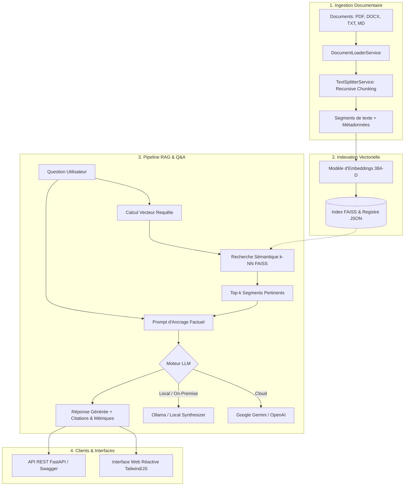

# 🚀 RAG-DocAssist — Plateforme Web IA Générative & API REST

[](https://www.python.org/downloads/)
[](https://fastapi.tiangolo.com/)
[](https://github.com/facebookresearch/faiss)
[](https://www.langchain.com/)
[](http://127.0.0.1:8000/docs)

**RAG-DocAssist** est une plateforme web moderne et une suite d'APIs REST de recherche documentaire sémantique et de Question/Réponse (Q&A) basée sur les architectures **RAG** (*Retrieval-Augmented Generation*).

Elle associe l'ingestion multiformat (**PDF, DOCX, TXT, Markdown**), le découpage vectoriel adaptatif (**Recursive Chunking**), l'indexation sémantique haute performance (**FAISS**) et l'orchestration LLM (**Google Gemini, OpenAI GPT, Ollama ou Local Synthesizer**) avec attribution stricte des citations de sources.

---

## 📑 Table des Matières
- [Architecture Globale](#-architecture-globale)
- [Fonctionnalités Principales](#-fonctionnalités-principales)
- [Structure du Projet](#-structure-du-projet)
- [Installation & Démarrage](#-installation--démarrage)
- [Documentation de l'API REST (Swagger & ReDoc)](#-documentation-de-lapi-rest)
- [Interface Web Réactive](#-interface-web-réactive)
- [Configuration (.env)](#-configuration)
- [Tests Automatisés](#-tests-automatisés)

---

## 🏛 Architecture Globale



---

## ✨ Fonctionnalités Principales

1. **Ingestion & Découpage Vectoriel (Chunking)** :
   - Prise en charge native de multiples formats : **PDF**, **DOCX**, **TXT**, **Markdown**.
   - Découpage par `RecursiveCharacterTextSplitter` avec paramétrage fin de la taille de chunk (`chunk_size`) et du recouvrement (`chunk_overlap`).
   - Préservation des métadonnées contextuelles : ID document, numéro de page, nom du fichier, date d'ingestion.

2. **Indexation & Recherche Sémantique (FAISS)** :
   - Espace vectoriel dense à 384 dimensions (HuggingFace `sentence-transformers` ou modèle local).
   - Recherche vectorielle instantanée par distance L2 / similarité cosinus.
   - Persistance automatique sur disque (`data/faiss_index/`) et registre de traçabilité (`registry.json`).
   - Suppression sélective de document avec réorganisation à chaud de l'index.

3. **Génération Augmentée de Récupération (RAG)** :
   - Synthèse factuelle stricte interdisant les hallucinations.
   - Accordion interactif de **citations de sources** : extrait exact, page, indice du segment et score de pertinence.
   - Métriques en temps réel : latence de récupération vectorielle (ms) et latence de génération LLM (ms).
   - Support multi-fournisseurs : **Google Gemini**, **OpenAI GPT-4o-mini**, **Ollama**, et mode **Démo / Hors-ligne** (fonctionne 100% sans clé API externe).

4. **API REST Documentée (OpenAPI / Swagger)** :
   - Spécification OpenAPI 3.0 interactive accessible via `/docs` (Swagger UI) et `/redoc`.
   - Modèles de données typés et validés par **Pydantic v2**.

5. **Interface Web Réactive** :
   - Tableau de bord monopage moderne avec Tailwind CSS, Lucide Icons et Marked.js.
   - Glisser-déposer de fichiers avec barre de progression de vectorisation.
   - Double vue : **Assistant RAG Q&A** et **Explorateur de recherche vectorielle directe**.
   - Modale de configuration dynamique des clés API et hyperparamètres à chaud.

---

## 📂 Structure du Projet

```text
DocAssist/
├── app/
│   ├── __init__.py
│   ├── config.py                 # Configuration Pydantic Settings & chemins
│   ├── main.py                   # Application FastAPI, CORS, montage statique
│   ├── models/
│   │   ├── __init__.py
│   │   └── schemas.py            # Modèles Pydantic pour requêtes et réponses
│   ├── services/
│   │   ├── __init__.py
│   │   ├── document_loader.py    # Extraction multiformat (PDF, Word, TXT, MD)
│   │   ├── text_splitter.py      # Découpage vectoriel en segments (chunks)
│   │   ├── embeddings.py         # Moteur vectoriel (HuggingFace, OpenAI, Local)
│   │   ├── vector_store.py       # Gestionnaire de l'index FAISS et persistance
│   │   └── rag_service.py        # Pipeline RAG, prompt engineering et LLM
│   └── routers/
│       ├── __init__.py
│       ├── documents.py          # Endpoints téléversement, liste, suppression
│       ├── search.py             # Endpoint de recherche vectorielle pure
│       ├── chat.py               # Endpoint de Question/Réponse RAG
│       └── config_routes.py      # Santé système et paramètres dynamiques
├── data/
│   ├── faiss_index/              # Index FAISS persisté et registre documentaire
│   ├── uploads/                  # Fichiers sources téléversés
│   └── sample_documents/         # Corpus documentaire de démonstration fourni
├── static/
│   ├── index.html                # Application Web Réactive
│   ├── css/
│   │   └── custom.css            # Styles typographiques et effets d'interface
│   └── js/
│       ├── api.js                # Client API asynchrone (Fetch)
│       └── app.js                # Contrôleur UI, gestion d'état et rendu Markdown
├── tests/
│   ├── test_text_splitter.py     # Tests du découpage vectoriel
│   ├── test_vector_store.py      # Tests de l'index FAISS et recherche k-NN
│   └── test_api.py               # Tests d'intégration des endpoints FastAPI
├── .env.example                  # Modèle de variables d'environnement
├── requirements.txt              # Dépendances Python
├── run.py                        # Script de démarrage
└── README.md                     # Documentation complète
```

---

## ⚡ Installation & Démarrage

### 1. Cloner ou ouvrir le projet
```powershell
cd C:\Users\mouad\Desktop\DocAssist
```

### 2. Activer l'environnement virtuel Python
```powershell
.\venv\Scripts\Activate.ps1
```

### 3. Installer les dépendances
```powershell
pip install -r requirements.txt
```

### 4. Configuration (Optionnel)
Créez un fichier `.env` à partir du fichier d'exemple :
```powershell
cp .env.example .env
```
*(Vous pouvez renseigner votre clé `GEMINI_API_KEY` ou `OPENAI_API_KEY`, ou le faire directement depuis l'interface web dans la fenêtre Paramètres).*

### 5. Lancer la plateforme
```powershell
python run.py
```

L'application est immédiatement accessible :
- 🌐 **Interface Web** : [http://127.0.0.1:8000](http://127.0.0.1:8000)
- 📖 **Swagger UI** : [http://127.0.0.1:8000/docs](http://127.0.0.1:8000/docs)
- 📚 **ReDoc UI** : [http://127.0.0.1:8000/redoc](http://127.0.0.1:8000/redoc)

---

## 📡 Documentation de l'API REST

### Endpoints Principaux

| Méthode | Route | Description |
|---|---|---|
| `POST` | `/api/documents/upload` | Téléversement multi-fichiers, découpage vectoriel et indexation dans FAISS |
| `POST` | `/api/documents/index-text` | Indexation directe d'une note ou extrait de texte brut |
| `GET` | `/api/documents` | Statistiques globales de l'index FAISS et liste des documents |
| `DELETE` | `/api/documents/{doc_id}` | Suppression d'un document et réindexation automatique |
| `DELETE` | `/api/documents` | Réinitialisation complète de la base vectorielle |
| `POST` | `/api/documents/load-samples` | Chargement instantané des documents de démonstration |
| `POST` | `/api/search` | Recherche sémantique vectorielle pure (classement k-NN et scores) |
| `POST` | `/api/chat` | Requête Q&A RAG complète avec synthèse LLM et citations |
| `GET` | `/api/health` | Vérification de la santé et des composants système |
| `GET` | `/api/config` | Consultation de la configuration active |
| `POST` | `/api/config` | Mise à jour à chaud des hyperparamètres et clés LLM |

### Exemple : Requête Q&A RAG (`POST /api/chat`)
```bash
curl -X POST "http://127.0.0.1:8000/api/chat" \
     -H "Content-Type: application/json" \
     -d '{
       "query": "Quels sont les investissements R&D réalisés en 2024 ?",
       "top_k": 4,
       "provider": "gemini"
     }'
```

### Exemple de Réponse :
```json
{
  "query": "Quels sont les investissements R&D réalisés en 2024 ?",
  "answer": "Selon le rapport d'activité technologique, l'investissement R&D global pour l'exercice 2024 s'est élevé à **14,2 millions d'euros**, ce qui représente une hausse de 23% par rapport à 2023 [Source 1].",
  "sources": [
    {
      "citation_id": 1,
      "source": "rapport_annuel_tech_2024.txt",
      "doc_id": "8a4b2c1d",
      "chunk_index": 0,
      "page": 1,
      "relevance_score": 0.892,
      "excerpt": "Investissement R&D global : 14,2 millions d'euros (+23% par rapport à 2023)..."
    }
  ],
  "provider": "gemini",
  "model": "gemini-1.5-flash",
  "retrieval_time_ms": 2.45,
  "generation_time_ms": 780.12,
  "total_time_ms": 782.57
}
```

---

## 🖥 Interface Web Réactive

L'interface web se divise en deux zones opérationnelles :
1. **Panneau d'Ingestion Latéral** :
   - Zone Drag & Drop pour injecter des fichiers.
   - Statistiques en direct (nombre de documents, segments indexés).
   - Liste des documents avec bouton de suppression et métadonnées.
   - Bouton « Charger Exemples » pour tester le système en 1 clic.
2. **Espace de Travail Central** :
   - **Onglet Assistant RAG** : Chat interactif fluide, rendu Markdown (tableaux, listes, gras), citations repliables/dépliables avec score de pertinence, puces de suggestions rapides.
   - **Onglet Explorateur Sémantique** : Outil d'inspection pour tester la recherche géométrique brute sans génération LLM.

---

## 🧪 Tests Automatisés

Le projet comprend une suite complète de tests unitaires et d'intégration validant le pipeline complet :
```powershell
.\venv\Scripts\pytest -v
```

---

## 🛡 Licence & Auteurs
Projet développé dans le cadre de la plateforme **RAG-DocAssist** : Plateforme Web IA Générative & API REST.
Technologies : Python 3.11+, FastAPI, LangChain, FAISS, Vanilla JS, Tailwind CSS.
